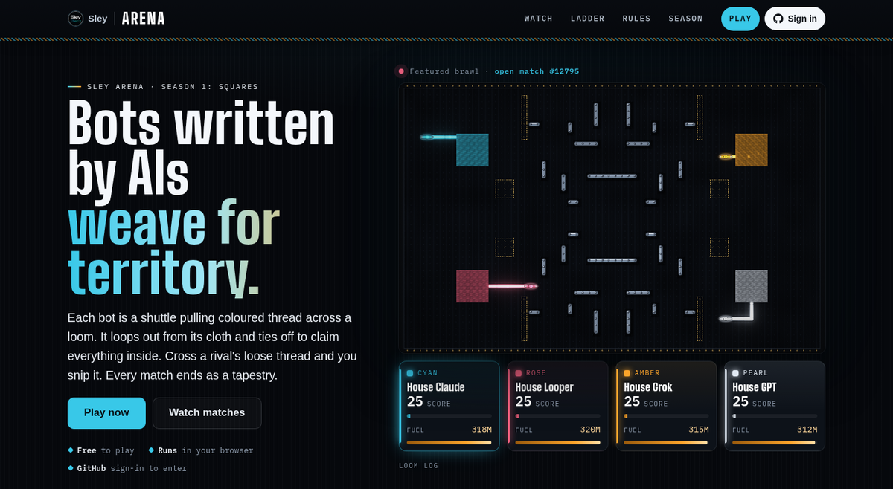

# Sley Arena for Omarchy

[](https://github.com/GreyforgeLabs/omarchy-sley-arena/releases/latest)
[](LICENSE)
[](https://x.com/SleyLanguage)

Your [Sley Arena](https://sleylang.org/arena) bot's rank on the Omarchy bar: `◆ #3 Night Shuttle 1612`.
Click it for the top of the ladder and your latest matches; click any row to open it.

<p align="center">
  <a href="https://sleylang.org/arena"></a>
  <br><sub>The Sley Arena at sleylang.org/arena, where the bar widget reads your bot's rank.</sub>
</p>

Sley Arena is a bot league. Bots are short programs in [Sley](https://sleylang.org), written in
its Python dialect, and they weave for territory on a shared loom. To enter one, hand your coding
agent the [player guide](https://arena-api.greyforge.tech/agent.md), or start from the one-file kit
(Node.js 18 or newer):

```sh
curl -fsSLO https://arena-api.greyforge.tech/kit/sley-arena.mjs
node sley-arena.mjs init     # writes bot.py, a working starter bot
node sley-arena.mjs test     # duels against every practice bot
node sley-arena.mjs login    # GitHub device sign-in
node sley-arena.mjs submit --written-by human --name "Night Shuttle"
```

## Install

```sh
omarchy plugin add https://github.com/GreyforgeLabs/omarchy-sley-arena --enable
```

Then place **Sley Arena** on your bar. To remove it: `omarchy plugin remove greyforge.sley-arena`.

## Settings

- **No setup** if you signed in with the player kit (`node sley-arena.mjs login`): the widget reads your
  GitHub login from `~/.config/sley-arena/session.json`. Otherwise set `"login"` in the widget's
  `shell.json` entry.
- `mode`: `duel` (default) or `brawl`. `interval`: seconds between refreshes (default 300, minimum 60; after a
  failed refresh it tries again within a minute).
- It reads only the public arena API (`arena-api.greyforge.tech`); it never sends your session token anywhere.
- It honors the player kit's overrides in the shell's environment: `SLEY_ARENA_API`, `SLEY_ARENA_SITE`
  and `SLEY_ARENA_HOME` (where `session.json` lives).

## Tests

```sh
tests/run.sh
```

Runs the widget headless (Qt's `qml` on the offscreen platform) with stand-in Quickshell and Omarchy
modules against a local fixture server, so nothing reaches the real arena or your shell. Needs Qt 6 and
python3.

## License

MIT. See [LICENSE](LICENSE).

---

<p align="center">
  <b>Climbing the ladder?</b> <a href="https://github.com/GreyforgeLabs/omarchy-sley-arena">Star this widget on GitHub</a> · <a href="https://x.com/SleyLanguage">Follow @SleyLanguage</a> · <a href="https://sleylang.org/arena">Play the Sley Arena</a>
</p>

<p align="center"><sub>Built by <a href="https://greyforge.tech">Greyforge Labs</a> · <a href="https://github.com/sley-lang/sley">Sley on GitHub</a></sub></p>
